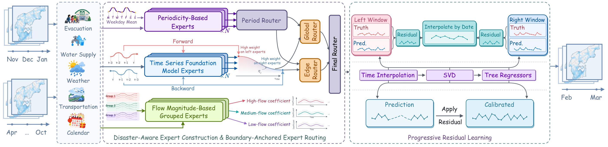

# 🌅 ReBOUND

### Reconstructing Post-Disaster Dynamic OD Flows with a Boundary-Guided Mixture of Experts

This repository provides the official implementation of **ReBOUND**, accepted at the **[4th ACM SIGSPATIAL International Workshop on Human Mobility Prediction (HuMob 2026)](https://takayabe0505.github.io/humob-2026/)**.

ReBOUND reconstructs daily origin–destination (OD) flows across prolonged gaps during post-disaster recovery. It combines heterogeneous experts through boundary-anchored routing informed by observations on both sides of the gap and public recovery information, then applies progressive residual learning to correct shared and OD-specific errors.



## Setup

```bash
bash setup.sh
```


## Reproduction

```bash
python train.py --config ReBOUND/config/rebound.json --reproduction true
```


## Training

Run pretraining, training, and evaluation in order:

```bash
python pretrain.py --foundation --gpus 0 --output ../ReBOUND_runs/foundation
python train.py --config ReBOUND/config/rebound.json --reproduction false --gpus 0 --foundation-dir ../ReBOUND_runs/foundation
```


## Code structure

```text
ReBOUND/
├── model/
│   ├── rebound.py                 # Complete ReBOUND model
│   └── modules/
│       ├── periodicity.py         # Periodicity-based experts
│       ├── foundation.py          # Foundation-model experts
│       ├── grouped.py             # Flow-magnitude grouped experts
│       ├── routing.py             # Boundary-anchored expert routing
│       ├── boundary_calibration.py
│       ├── residual_features.py
│       └── residual.py            # Progressive residual learning
├── training/                     # Expert, router, and residual fitting
├── config/                       # Model settings and protocol
└── utils/                        # Data loading, evaluation, and export
Data/                             # Masked training inputs and observations
Pretrained/                       # Expert banks, routing weights, tree models
reproduce.py                      # Reproduction entry point
pretrain.py                       # Expert / Chronos pretraining
train.py                          # Training and pretrained reproduction
```


## Acknowledgements

We thank the authors of the following open-source projects for their valuable contributions to our implementation:

- [Chronos-2](https://github.com/amazon-science/chronos-forecasting)
- [TimesFM](https://github.com/google-research/timesfm)

